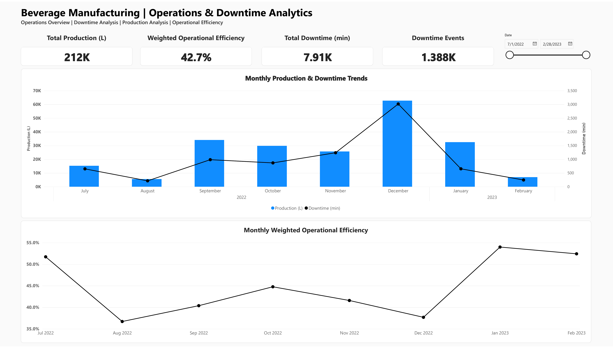
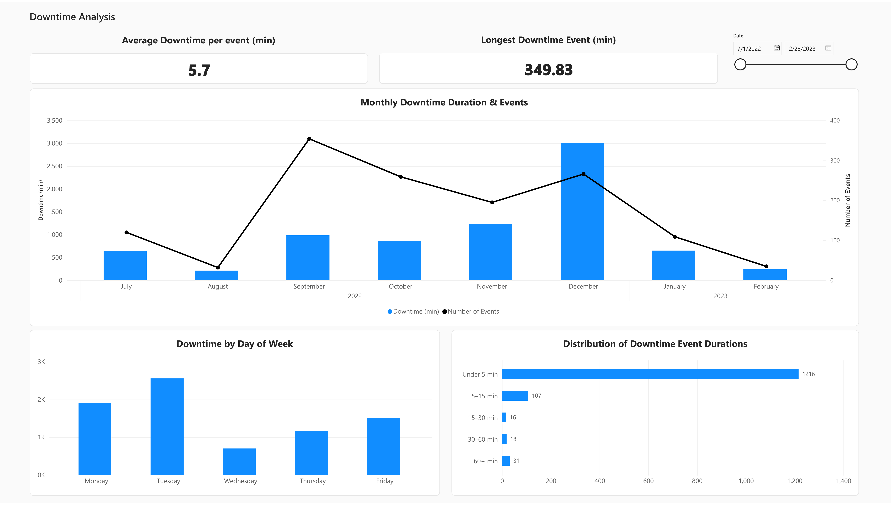
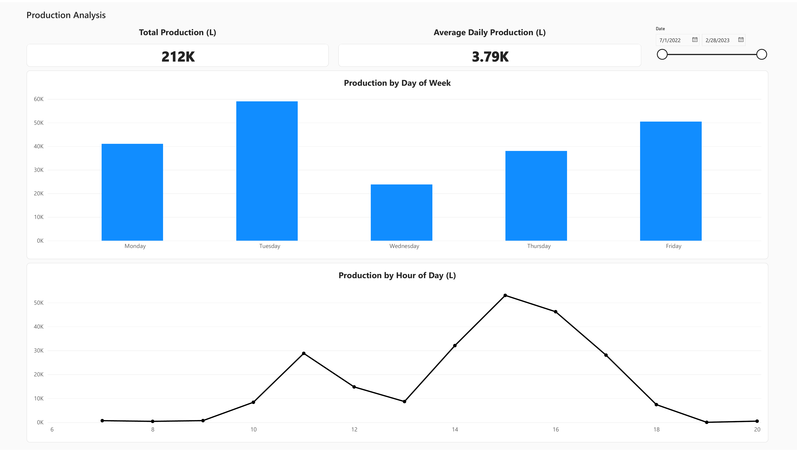
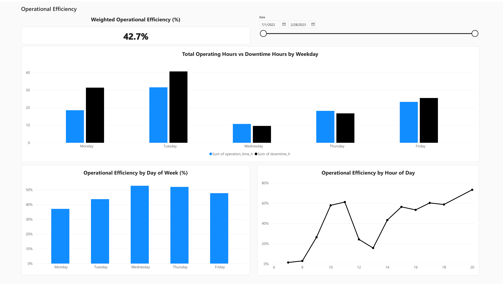

# Beverage Manufacturing | Operations & Downtime Analytics

A four-page Power BI report for exploring production volume, downtime events, and operational efficiency on an industrial beverage filling line.



## Project overview

This report turns eight months of production and downtime records into an operations-focused view of line performance. The analysis covers July 2022 through February 2023 and separates the work into four pages:

1. **Operations Overview** - production, downtime, event count, and weighted efficiency trends.
2. **Downtime Analysis** - downtime duration, event frequency, weekday patterns, and duration bands.
3. **Production Analysis** - daily and hourly production patterns.
4. **Operational Efficiency** - operating time, downtime, and efficiency by weekday and hour.

The report is a portfolio analysis of a public research dataset. It does **not** represent work for, or performance of, a named beverage company.

## Headline results

For the full report period shown in the published report:

- Total production: **212K litres**
- Weighted operational efficiency: **42.7%**
- Total downtime: **7.91K minutes**
- Downtime events: **1,388**
- Average downtime per event: **5.7 minutes**
- Longest downtime event: **349.83 minutes**

The visuals show that December combined the highest monthly production with the highest monthly downtime. Most recorded downtime events were short: 1,216 of 1,388 events fell below five minutes. Tuesday had the greatest production and downtime totals, while hourly efficiency varied substantially across the working day.

## Report pages

### 1. Operations Overview


### 2. Downtime Analysis



### 3. Production Analysis



### 4. Operational Efficiency



## Data provenance and attribution

The semantic model's four source tables and field names match the public dataset **Industrial Production Time-Series Dataset from a Beverage Bottling Line (2022-2023)**, published on Zenodo by Gabriel Augusto David, Paulo Monteiro de Carvalho Monson, and Cristiano Soares Junior.

- Dataset record and download: <https://doi.org/10.5281/zenodo.18146866>
- Associated article: *IoT-Driven Deep Learning for Enhanced Industrial Production Forecasting*, IEEE Internet of Things Journal (2024), DOI <https://doi.org/10.1109/JIOT.2024.3447579>
- Dataset license: **CC BY 4.0**

According to the dataset documentation, the records came from a real industrial filling machine monitored with an IIoT system. The public source does not identify a company; this repository therefore does not assign one. No original dataset file is redistributed here. Download the authoritative workbook (`production_raw.xlsx`) from Zenodo and retain its attribution if reproducing the project.

## Semantic model

The Power BI model contains five tables:

- `processed_hourly` - hourly production counts
- `daily_operation_summary` - daily production, monitored time, operating time, pauses, and efficiency
- `hourly_operation_breakdown` - hourly monitored, operating, and downtime hours
- `downtime_event_log` - event-level downtime records
- `Calendar` - calculated date table used to filter and group all four fact tables

Each source table has a many-to-one relationship to `Calendar`. Calculations use ratio-of-sums measures for efficiency so longer monitored periods contribute proportionally, rather than averaging row-level percentages.

The verified DAX definitions are documented in [`measures.md`](docs/measures.md). Transformation and analytical choices are documented in [`methodology.md`](docs/methodology.md).

## Tools and skills demonstrated

- Power BI Service and semantic modelling
- Power Query / data preparation
- DAX measures and calculated columns
- Date modelling and one-to-many relationships
- Dual-axis trend analysis
- Distribution banding and sort-by columns
- Interactive date filtering
- Operational KPI design and report storytelling

## Repository contents

```text
.
|-- README.md
|-- docs/
|   |-- methodology.md
|   |-- measures.md
|   `-- report-export.pdf
`-- screenshots/
    |-- 01-operations-overview.png
    |-- 02-downtime-analysis.png
    |-- 03-production-analysis.png
    `-- 04-operational-efficiency.png
```

## Reproducing the analysis

1. Download `production_raw.xlsx` from the cited Zenodo record.
2. Load its four worksheets into Power BI.
3. Standardise date, time, and numeric types; calculate event duration in minutes where needed.
4. Create a calendar table spanning the fact-table dates and relate all source tables to it.
5. Add the verified measures and downtime duration bands described in `docs/`.
6. Build the four report pages and apply a shared date slicer.

The `.pbix` file is not included in this repository package because it was not available locally during publication. The PDF, screenshots, model structure, source attribution, and verified measures are included as reproducible evidence of the completed report.

## Notes

- Values shown in screenshots reflect the full date range, 1 July 2022 to 28 February 2023.
- “Gallon” is retained where it appears in the source field names. Report-facing production measures convert gallons to litres using `1 US gallon = 3.785411784 litres`.
- This repository documents the beverage operations project only. It is separate from the sales Power BI project.
