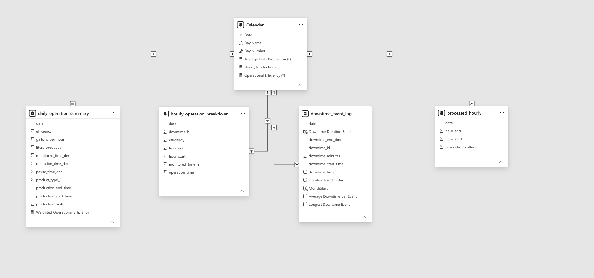

# Beverage Manufacturing | Operations & Downtime Analytics

A four-page Power BI report for exploring production volume, downtime events, and operational efficiency on an industrial beverage filling line.


## Project overview

This report turns eight months of production and downtime records into an operations-focused view of line performance. The analysis covers July 2022 through February 2023 and separates the work into four pages:

1. **Operations Overview** - production, downtime, event count, and weighted efficiency trends.
2. **Downtime Analysis** - downtime duration, event frequency, weekday patterns, and duration bands.
3. **Production Analysis** - daily and hourly production patterns.
4. **Operational Efficiency** - operating time, downtime, and efficiency by weekday and hour.

The report is a portfolio analysis of a public research dataset. It does **not** represent work for, or performance of, a named beverage company.

## Headline results

For the full report period shown in the published report:

- Total production: **212K litres**
- Weighted operational efficiency: **42.7%**
- Total downtime: **7.91K minutes**
- Downtime events: **1,388**
- Average downtime per event: **5.7 minutes**
- Longest downtime event: **349.83 minutes**

The visuals show that December combined the highest monthly production with the highest monthly downtime. Most recorded downtime events were short: 1,216 of 1,388 events fell below five minutes. Tuesday had the greatest production and downtime totals, while hourly efficiency varied substantially across the working day.

## Report pages

## Business Questions, Key Findings & Recommendations

This analysis examines production performance, downtime patterns, and operational efficiency using industrial beverage filling-line data from July 2022 to February 2023. The objective is to identify operational patterns that could support further investigation and data-informed production planning.

### 1. How efficiently does the production line operate?

**Finding:** The line recorded a weighted operational efficiency of **42.7%** over the analysed period. This metric is calculated as total operating time divided by total monitored time, rather than as a simple average of daily efficiency percentages.

**Interpretation:** Operating time represented approximately 42.7% of monitored time under the dataset's definitions. Efficiency also varied across months, weekdays, and hours.

**Recommendation:** Investigate periods of lower efficiency and assess whether the observed variation is associated with scheduled pauses, production schedules, or recorded downtime. The dataset does not establish the underlying causes.

### 2. When does the greatest downtime occur?

**Finding:** Total recorded downtime was approximately **7,910 minutes**. December 2022 had the highest monthly downtime total, while Tuesday recorded the highest cumulative downtime among weekdays.

**Interpretation:** Downtime was unevenly distributed across the reporting period. December also recorded the highest monthly production, so its elevated downtime total should not automatically be interpreted as poorer performance without considering production activity and monitored hours.

**Recommendation:** Compare downtime rates against monitored time and production volume before identifying priority periods for operational investigation.

### 3. Are downtime events predominantly short or long?

**Finding:** The report recorded **1,388 downtime events**, averaging **5.7 minutes** per event. The longest recorded event lasted **349.83 minutes**. Of all recorded events, **1,216 (approximately 87.6%)** lasted under five minutes.

**Interpretation:** Most interruptions were short in duration, although the dataset also includes substantially longer events. Event frequency alone does not indicate which duration category contributed the most total downtime.

**Recommendation:** Investigate both recurring short interruptions and unusually long events. Compare their cumulative downtime contributions before prioritising corrective actions.

### 4. When is production activity highest?

**Finding:** Total production was approximately **212,000 litres** during the reporting period. Tuesday had the highest cumulative production among weekdays. Hourly production varied considerably, with the highest observed aggregate hourly production around 15:00.

**Interpretation:** Production activity was not evenly distributed throughout the working day or across weekdays. These differences may reflect operating schedules or production activity, but the available data does not establish their causes.

**Recommendation:** Compare production by hour against monitored operating time and downtime to identify periods that merit further investigation.

### 5. What operational priorities emerge from the analysis?

The descriptive findings suggest three areas for further investigation:

1. **Downtime concentration:** Examine December's elevated downtime alongside its high production volume, using exposure-adjusted comparisons where possible.
2. **Interruption patterns:** Evaluate the cumulative impact of frequent short stoppages separately from longer downtime events.
3. **Efficiency variation:** Investigate low-efficiency periods using more detailed operational, equipment, and scheduling data.

### Overall Conclusion

The Power BI analysis consolidates production, downtime, and operational-efficiency records into four interactive report pages. Across July 2022 to February 2023, the line recorded approximately **212K litres of production**, **7.91K minutes of downtime**, **1,388 downtime events**, and **42.7% weighted operational efficiency**.

The findings highlight variations in production activity, downtime concentration, and efficiency across time periods. They provide a basis for prioritising further operational analysis, but do not demonstrate causal relationships or quantify potential financial savings.

**Analytical limitation:** The public dataset does not provide sufficient equipment-level fault, operator, or shift information to establish root causes. Recommendations are investigative priorities, not verified operational improvements.

### 1. Operations Overview


### 2. Downtime Analysis


### 3. Production Analysis


### 4. Operational Efficiency


## Data provenance and attribution

The semantic model's four source tables and field names match the public dataset **Industrial Production Time-Series Dataset from a Beverage Bottling Line (2022-2023)**, published on Zenodo by Gabriel Augusto David, Paulo Monteiro de Carvalho Monson, and Cristiano Soares Junior.

- Dataset record and download: <https://doi.org/10.5281/zenodo.18146866>
- Associated article: *IoT-Driven Deep Learning for Enhanced Industrial Production Forecasting*, IEEE Internet of Things Journal (2024), DOI <https://doi.org/10.1109/JIOT.2024.3447579>
- Dataset license: **CC BY 4.0**

According to the dataset documentation, the records came from a real industrial filling machine monitored with an IIoT system. The public source does not identify a company; this repository therefore does not assign one. No original dataset file is redistributed here. Download the authoritative workbook (`production_raw.xlsx`) from Zenodo and retain its attribution if reproducing the project.

## Semantic model

The Power BI model contains five tables:

- `processed_hourly` - hourly production counts
- `daily_operation_summary` - daily production, monitored time, operating time, pauses, and efficiency
- `hourly_operation_breakdown` - hourly monitored, operating, and downtime hours
- `downtime_event_log` - event-level downtime records
- `Calendar` - calculated date table used to filter and group all four fact tables

Each source table has a many-to-one relationship to `Calendar`. Calculations use ratio-of-sums measures for efficiency so longer monitored periods contribute proportionally, rather than averaging row-level percentages.

The verified DAX definitions are documented in [`measures.md`](docs/measures.md). Transformation and analytical choices are documented in [`methodology.md`](docs/methodology.md).

### Power BI Data Model Diagram

The diagram below shows the five-table semantic model and the relationships connecting the four operational tables to the shared Calendar dimension.



## Interactive Dashboard Demonstration

Watch a walkthrough of the four-page Power BI dashboard, demonstrating report navigation, interactive filtering, production analysis, downtime monitoring, and operational efficiency metrics.

[](https://youtu.be/qQbN8jfCTiE)

**[Watch the full dashboard demonstration on YouTube](https://youtu.be/qQbN8jfCTiE)**

The video complements the report screenshots, semantic model, verified DAX measures, and methodology documented in this repository.

## Tools and skills demonstrated

- Power BI Service and semantic modelling
- Power Query / data preparation
- DAX measures and calculated columns
- Date modelling and one-to-many relationships
- Dual-axis trend analysis
- Distribution banding and sort-by columns
- Interactive date filtering
- Operational KPI design and report storytelling

## Repository contents

```text
.
|-- README.md
|-- docs/
|   |-- methodology.md
|   |-- measures.md
|   `-- report-export.pdf
`-- screenshots/
    |-- 01-operations-overview.png
    |-- 02-downtime-analysis.png
    |-- 03-production-analysis.png
    `-- 04-operational-efficiency.png
```

## Reproducing the analysis

1. Download `production_raw.xlsx` from the cited Zenodo record.
2. Load its four worksheets into Power BI.
3. Standardise date, time, and numeric types; calculate event duration in minutes where needed.
4. Create a calendar table spanning the fact-table dates and relate all source tables to it.
5. Add the verified measures and downtime duration bands described in `docs/`.
6. Build the four report pages and apply a shared date slicer.

The `.pbix` file is not included in this repository package because it was not available locally during publication. The PDF, screenshots, model structure, source attribution, and verified measures are included as reproducible evidence of the completed report.

## Notes

- Values shown in screenshots reflect the full date range, 1 July 2022 to 28 February 2023.
- “Gallon” is retained where it appears in the source field names. Report-facing production measures convert gallons to litres using `1 US gallon = 3.785411784 litres`.
- This repository documents the beverage operations project only. It is separate from the sales Power BI project.
